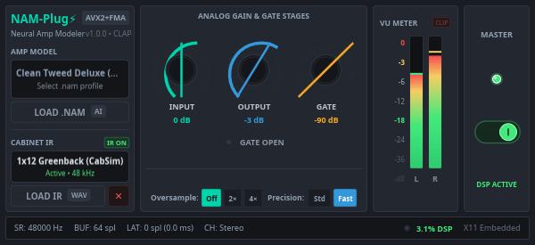

<!--
SPDX-License-Identifier: GPL-3.0-or-later
Copyright (c) 2026 Fábio Henrique de Lima Silva (fhl.bsb@gmail.com) All rights reserved.
-->

# NAM-Plug

         

**NAM-Plug** is a high-performance, ultra-low latency CLAP (CLever Audio Plug-in) audio plugin for real-time [Neural Amp Modeler (NAM)](https://www.neuralampmodeler.com/) simulation on Linux DAWs (Bitwig Studio, REAPER, Studio One, etc.).

Powered directly by the [`NeuralAmpModeler-rs`](https://github.com/fabiohl/NeuralAmpModeler-rs) neural DSP engine, NAM-Plug brings world-class guitar amplifier and pedal modeling into modern Linux music production—combining **strict zero-allocation real-time safety**, SIMD AVX2/FMA vectorization, sub-millisecond audio determinism, and dual-oracle bit-exact fidelity.

Whether tracking live guitar with sub-millisecond roundtrip latency or producing dense, multi-track studio sessions, NAM-Plug delivers uncompromising sonic accuracy and rock-solid stability.

## 🌟 Why Choose NAM-Plug?

* **Pristine Tone & Proven Parity:** Validated against canonical C++ NAMCore and double-precision $f64$ oracles ($>136.4\text{ dB}$ SNR for WaveNet, $>150.3\text{ dB}$ for ConvNet).
* **Hard Real-Time Determinism:** Zero heap allocations, zero locks, and zero blocking syscalls on the audio thread. No dropouts, audio glitches, or xruns.
* **Modern Linux DAW Native:** Native CLAP 1.2+ implementation featuring a hardware-accelerated Slint GUI with **native X11 XEmbed host panel embedding**, sample-accurate automation, dynamic latency compensation (PDC), and zero-friction Flatpak extension support.

---

## 🎨 Visual Overview & Interface



*The hardware-accelerated Slint interface running inside a Linux DAW. Organized into five ergonomic zones:*

1. **Asset Selection (Left Panel):** Load `.nam` / `.namb` neural amp models and `.wav` speaker cabinet impulse responses (IRs).
2. **Gain Staging & Noise Gate (Center Knobs):** Input/Output trim ($\pm 20\text{ dB}$) and an integrated downward noise gate ($-90\text{ to }-40\text{ dB}$).
3. **Quality & Mode Toggles:** Anti-aliasing oversampling (`Off`, `2x`, `4x`), SIMD activation math (`Standard` vs `Fast`), and click-free `ACTIVE` bypass.
4. **Precision Metering:** Adaptive mono/stereo peak level meters with calibrated IEC 60268-10 PPM ballistics.
5. **Real-Time Telemetry Bar (Footer):** Live status reporting sample rate, added latency, DSP CPU load %, cycles per block, quantum size, RT thread priority, and xrun counts.

---

## ⚡ Key Architectural Highlights

* **Pure Rust & Strict Real-Time Determinism:** Inherits the hard real-time safety guarantees of `NeuralAmpModeler-rs`. The audio processing callback performs zero heap allocations, zero heap deallocations, and zero mutex locks (audited via `CountingAllocator`). Dropped models, IRs, and oversampling buffers retire asynchronously through a 3-tier lock-free SPSC garbage-collection cascade (*SPSC queue → 16-slot parking lot → overflow ring buffer*) with rollback guards.
* **SIMD AVX2 Vectorization & Zero-Vtable Dispatch:** Enforces the `x86-64-v3` (AVX2/FMA/BMI2) instruction set baseline. Compute kernels employ tap-major memory layouts and `sum0..sum3` instruction-level parallelism unrolling. Static monomorphization via `dispatch_simd!` eliminates virtual function tables (vtables) and indirect function pointers from the audio path.
* **Dual-Oracle Numerical Parity:** Formally certified against canonical C++ NAMCore ($f32$) and double-precision ($f64$) mathematical oracles across 52 baseline envelopes (`docs/quality-contract.json`). Typical WaveNet models achieve ESR $< 2.31 \times 10^{-14}$ (SNR $> 136.4\text{ dB}$, MR-STFT $< 6.5 \times 10^{-6}$), while ConvNet achieves ESR $< 9.33 \times 10^{-16}$ (SNR $> 150.3\text{ dB}$).
* **Native CLAP 1.2+ Standard Integration:** Built directly upon the `clack` framework, exposing a clean, translation-free CLAP implementation. Fully supports sample-accurate parameter automation, project state persistence (JSON serialization with SHA-256 asset verification), host latency reporting with dynamic PDC (`clap_plugin_latency`), and native host extensions (`audio-ports`, `gui`, `params`, `state`, `preset-discovery`, `render`, `tail`, `track-info`).
* **Hardware-Accelerated Slint GUI with Native X11 Embedding:** Declarative user interface rendered via FemtoVG / OpenGL with **native X11 XEmbed host panel embedding** into Bitwig Studio and REAPER, plus Wayland and X11 floating window fallbacks. A dedicated 60 Hz event-loop thread polls lock-free atomic view models with 0% audio thread overhead.
* **Complete Integrated Tone Pipeline:** Includes a native 256-phase minimum-phase Kaiser sinc resampler ($0.7\text{–}1.3\text{ µs}$ execution, $>105\text{ dB}$ stopband, 0 pre-ringing) adapting any model sample rate to host rates (44.1, 48, 96, 192 kHz), Uniform-Partitioned Overlap-Save (UPOLS) FFT cabinet IR convolution ($1.3\text{ µs}$ for 512-sample IRs), polyphase half-band oversampling (2×/4×), and branchless 32 ms equal-power crossfaded bypass.
* **Binary `.namb` v2 Container Support:** Loads pre-transposed binary models (Gate-Major LSTM, Interleaved-4 WaveNet) with IEEE 802.3 CRC32 integrity validation, slashing model loading and hot-swap times from $\sim 50\text{ ms}$ to $< 1\text{ ms}$.
* **Sandbox-Ready Flatpak Audio Plugin Extension:** Distributed as an official Flatpak extension (`org.freedesktop.LinuxAudio.Plugins.NAMPlug`) extending `org.freedesktop.LinuxAudio.BaseExtension` 25.08, providing automatic discovery in sandboxed DAWs (Bitwig, REAPER, Studio One) without compromising filesystem security.

---

## 🥊 Feature Showcase

| Feature / Attribute            | Technical Implementation                                                             | Benefit & Impact                                                                         |
|:------------------------------ |:------------------------------------------------------------------------------------ |:---------------------------------------------------------------------------------------- |
| **Inference Topologies**       | WaveNet (A1/A2), LSTM (1- & 2-layer, multi-I/O), ConvNet, Linear FIR/FFT, Sequential | Comprehensive NAM model coverage with native Rust execution speed                        |
| **Plugin Standard**            | Native CLAP 1.2+ via `clack-plugin` & `clack-extensions`                             | Zero translation layer; sample-accurate automation, dynamic PDC, and full state saving   |
| **RT Determinism**             | Zero heap alloc/free, zero mutex locks, 3-tier lock-free GC cascade                  | Deterministic, dropout-free audio under sub-millisecond buffer sizes (32–64 samples)     |
| **SIMD Acceleration**          | Mandatory `x86-64-v3` (AVX2/FMA) baseline; static `dispatch_simd!` dispatch          | WaveNet Standard ≈ 41.8 µs / LSTM 1×16 ≈ 6.8 µs per 64-sample block (Ryzen 7 5700U)      |
| **Dual-Oracle Parity**         | Validated against C++ NAMCore ($f32$) and double-precision $f64$                     | Bit-exact fidelity ($>136.4\text{ dB}$ SNR WaveNet, $>150.3\text{ dB}$ SNR ConvNet)      |
| **Native Polyphase Resampler** | 256 phases × 64 taps Kaiser sinc resampler (minimum-phase cepstrum)                  | Pristine multi-rate conversion (>105 dB stopband, < 0.05 dB ripple) in 0.7–1.3 µs        |
| **Cabinet IR Convolution**     | Uniform-Partitioned Overlap-Save (UPOLS) FFT convolution engine (.wav)               | Ultra-low-overhead speaker cabinet simulation ($1.3\text{ µs}$ for 512-sample IRs)       |
| **Anti-Aliasing Oversampling** | Half-band polyphase FIR filters (`Off`, `2x`, `4x`, >100 dB stopband)                | Eliminates non-linear high-frequency foldover/aliasing in high-gain models               |
| **Activation Precision**       | `Standard` (exact Taylor minimax) vs `Fast` (Padé polynomial approximations)         | User-selectable balance between floating-point precision (+89.5 dB SNR) and CPU cycles   |
| **Graphical User Interface**   | Slint 1.18 declarative UI (FemtoVG/OpenGL via `winit`)                               | Native X11 XEmbed host panel embedding, Wayland/X11 floating fallback, 60 FPS metering   |
| **Denormal Armor**             | Symmetric −220 dBFS dither injection + hardware MXCSR FTZ/DAZ                        | Eliminates 10–100× CPU microcode penalties during digital silence with zero net DC drift |
| **Bypass Crossfader**          | 32 ms equal-power crossfade with branchless FMA loop & phase compensation            | Smooth, pop-free transitions with zero phase cancellation                                |
| **Dynamic Latency (PDC)**      | Cold-path cached effective latency with dynamic `clap_plugin_latency`                | Instant host Plugin Delay Compensation with 0 per-block audio thread overhead            |
| **Binary `.namb` v2 Format**   | Pre-transposed memory layout (Gate-Major LSTM, Interleaved-4 WaveNet) with CRC32     | Reduces model loading and DAW track hot-swap time from ~50 ms to $< 1\text{ ms}$         |
| **Flatpak Extension**          | `org.freedesktop.LinuxAudio.Plugins.NAMPlug` on BaseExtension 25.08                  | Seamless 1-click loading in sandboxed Flatpak DAWs without host permissions              |
| **Release Optimization**       | 5-phase PGO + LLVM-BOLT pipeline with demangled assembly verification                | Maximized CPU instruction throughput and minimized I-Cache misses                        |

---

## 🧠 Supported Neural Architectures

| Architecture   | Supported Configurations                                  | Dynamic Fallback  | Notes                                                  |
|:-------------- |:--------------------------------------------------------- |:----------------- |:------------------------------------------------------ |
| **WaveNet A1** | Standard (CH=16), Lite (12), Feather (8), Nano (4)        | `WaveNetModelDyn` | Dilated causal 1D convs, gated tanh/sigmoid            |
| **WaveNet A2** | Full (CH=8), Lite (CH=3), Cascade                         | `WaveNetA2Dyn`    | Headroom-optimized modern NAM architecture             |
| **LSTM**       | 10 profiles: 1-layer (hidden 3–40), 2-layer (hidden 8–24) | `LstmModelDyn`    | Pre-transposed gate-major SIMD GEMV kernels; multi-I/O |
| **ConvNet**    | Causal Conv1D + BatchNorm1D + activation                  | —                 | Fast feed-forward models; grouped conv & multi-I/O     |
| **Linear**     | Direct FIR or Partitioned FFT convolution                 | —                 | Clean tone equalization & linear filters               |
| **Sequential** | Composite multi-stage pipeline                            | —                 | Serial composition of arbitrary supported models       |
| **Slimmable**  | Multi-submodel bundles with runtime quality transitions   | —                 | Adaptive compute bundles with dynamic crossfading      |

---

## 🏆 Measured Audio Fidelity & Real-Time Performance

### Dual-Oracle Parity & Perceptual Validation

Accuracy is strictly enforced against two co-equal reference oracles across 52 model baselines (`NeuralAmpModeler-rs/docs/quality-contract.json`):

1. **Canonical C++ NAMCore Reference ($f32$):** Verifies bit-exact behavioral parity across WaveNet, LSTM, ConvNet, and Linear models.
2. **Double-Precision Reference ($f64$):** Quantifies numerical ideality and eliminates floating-point rounding divergence.

| Architecture / Model | Error-to-Signal Ratio (ESR) | Signal-to-Noise Ratio (SNR) | Multi-Resolution STFT  |
|:-------------------- |:--------------------------- |:--------------------------- |:---------------------- |
| **WaveNet Standard** | $< 2.31 \times 10^{-14}$    | $> 136.4\text{ dB}$         | $< 6.5 \times 10^{-6}$ |
| **WaveNet A2**       | $< 2.10 \times 10^{-14}$    | $> 136.8\text{ dB}$         | $< 5.8 \times 10^{-6}$ |
| **ConvNet ReLU**     | $< 9.33 \times 10^{-16}$    | $> 150.3\text{ dB}$         | $< 1.2 \times 10^{-6}$ |
| **LSTM 1-Layer**     | $< 1.45 \times 10^{-14}$    | $> 138.2\text{ dB}$         | $< 4.1 \times 10^{-6}$ |

*All models satisfy spectral convergence and LUFS loudness constancy invariants, ensuring identical tone and frequency response compared to reference captures.*

### 1. Isolated DSP Engine Microbenchmarks (`NeuralAmpModeler-rs`)

Execution times measured per **64-sample block at 48 kHz** ($1.33\text{ ms}$ real-time deadline budget) on an AMD Ryzen 7 5700U (`x86-64-v3` AVX2 baseline, `rustc 1.99.0`):

| Component / Profile                           | Execution Time | RT Budget Used | Theoretical Tracks per Core |
|:--------------------------------------------- |:-------------- |:-------------- |:--------------------------- |
| **WaveNet Standard (CH=16)**                  | **41.8 µs**    | 3.1%           | ~31 tracks                  |
| **WaveNet Lite (CH=12)**                      | **57.2 µs**    | 4.3%           | ~23 tracks                  |
| **WaveNet Feather (CH=8)**                    | **20.1 µs**    | 1.5%           | ~66 tracks                  |
| **WaveNet Nano (CH=4)**                       | **18.3 µs**    | 1.4%           | ~72 tracks                  |
| **WaveNet A2 Full (CH=8)**                    | **19.8 µs**    | 1.5%           | ~67 tracks                  |
| **WaveNet A2 Lite (CH=3)**                    | **14.0 µs**    | 1.1%           | ~95 tracks                  |
| **LSTM 1-Layer (Hidden=16)**                  | **6.8 µs**     | 0.5%           | ~195 tracks                 |
| **LSTM 2-Layer (Hidden=8)**                   | **7.6 µs**     | 0.6%           | ~175 tracks                 |
| **ConvNet**                                   | **9.5 µs**     | 0.7%           | ~140 tracks                 |
| **Linear FIR (RF=4 Direct)**                  | **0.13 µs**    | 0.01%          | >1,000 tracks               |
| **DSP Resampler (44.1 → 48 kHz)**             | **1.3 µs**     | 0.10%          | >1,000 tracks               |
| **Cabinet IR Convolver (UPOLS 512)**          | **1.3 µs**     | 0.10%          | >1,000 tracks               |
| **Full Pipeline Base (Model + CabSim)**       | **42.8 µs**    | 3.2%           | ~31 tracks                  |
| **Full Pipeline HQ (Model + CabSim + 4× OS)** | **174.4 µs**   | 13.1%          | ~7 tracks                   |

### 2. End-to-End CLAP Plugin Binary Certification (`nam_plug.clap`)

In addition to core DSP benchmarks, the distributed release artifact (`~/.clap/nam_plug.clap`) undergoes automated real-time certification via `nam_perf_guard --certify` under realistic DAW host conditions (event queues, parameter smoothing, crossfading, buffer routing) after PGO + LLVM-BOLT optimization:

| Host Scenario / Topology        | Block Size  | p50 Latency  | p99 Latency  | Deadline Budget | Budget Used (p50 / p99) | Headroom  | Certification Status  |
|:------------------------------- |:----------- |:------------ |:------------ |:--------------- |:----------------------- |:--------- |:--------------------- |
| **WaveNet A1 Standard**         | 64 samples  | **102.2 µs** | **111.8 µs** | 1.33 ms         | 7.7% / 8.4%             | **90.1%** | ✅ PASS (Certified)   |
| **WaveNet A1 Standard**         | 128 samples | **201.4 µs** | **219.5 µs** | 2.67 ms         | 7.6% / 8.2%             | **90.3%** | ✅ PASS (Certified)   |
| **WaveNet A2 Slimmable**        | 64 samples  | **49.9 µs**  | **60.1 µs**  | 1.33 ms         | 3.7% / 4.5%             | **94.7%** | ✅ PASS (Certified)   |
| **LSTM 1×3**                    | 64 samples  | **12.4 µs**  | **19.9 µs**  | 1.33 ms         | 0.9% / 1.5%             | **98.2%** | ✅ PASS (Certified)   |
| **CLAP Passthrough (No Model)** | 64 samples  | **2.3 µs**   | **2.4 µs**   | 1.33 ms         | 0.17% / 0.18%           | **99.8%** | ✅ PASS (Certified)   |

> [!TIP]
> **What This Means In Your DAW:**
> Even under worst-case p99 spikes with a heavy WaveNet A1 amplifier model, NAM-Plug consumes less than **8.4%** of a 64-sample buffer deadline ($1.33\text{ ms}$ at 48 kHz). The CLAP plugin wrapper overhead is only **2.3 µs**, leaving over **90% of your CPU budget** free for synths, mixing consoles, and complex FX chains.

---

## 🎛️ Beginner's Guide & DAW Workflow

New to Neural Amp Modeler or guitar amp simulation? Here is everything you need to get up and running in minutes.

### 1. Understanding the Guitar Tone Signal Chain

In guitar production, an authentic recorded amp tone consists of two distinct components:

1. **The Amplifier Head (`.nam` / `.namb` file):** Captures the nonlinear tube saturation, distortion harmonics, EQ tone stack, and compression of the physical guitar amp or overdrive pedal.
2. **The Speaker Cabinet (`.wav` Impulse Response):** Captures the acoustic frequency curve of the physical speaker cabinet, speaker cone resonance, microphone type, and mic placement.

> [!IMPORTANT]
> **Pair Your Amp Model with a Cab IR!**
> An amp model without a speaker cabinet IR will sound harsh and fizzy (like plugging an amp head directly into a PA mixer). Unless your `.nam` file is labeled as a *"Full Rig"* (which bundles both amp and cabinet), **always load both a Model and a Cabinet IR**.

### 2. Where to Find Free Community Models & IRs

* **[TONE3000](https://tone3000.com/):** Thousands of curated community captures of boutique tube amps, vintage heads, bass rigs, and overdrive pedals.
* **[NeuralAmpModeler.com](https://www.neuralampmodeler.com/):** The official home and model repository for the NAM ecosystem.
* **Cabinet IRs:** Any standard 24-bit or 32-bit float mono `.wav` speaker impulse response (44.1 kHz, 48 kHz, or 96 kHz) works out of the box with zero manual conversion.

### 3. Quick-Start Step-by-Step

```text
[Dry Guitar DI] ➔ [INPUT Gain] ➔ [GATE] ➔ [Neural Model (.nam)] ➔ [Cab IR (.wav)] ➔ [OUTPUT Gain] ➔ [DAW Track]
```

1. **Insert NAM-Plug:** Add NAM-Plug as an audio effect on your dry guitar or bass track. Set your audio interface gain so your guitar's strongest picking hits around **-18 to -12 dBFS**.
2. **Load an Amp Model:** Click **`Load Model`** in the left panel and select your `.nam` or `.namb` file.
3. **Load a Cabinet IR:** Click **`Load IR`** and select your `.wav` speaker impulse response.
4. **Dial in Gain Staging:**
   * Adjust **`INPUT`** ($\pm 20\text{ dB}$) to feed the model the right amount of drive.
   * Adjust **`OUTPUT`** ($\pm 20\text{ dB}$) to balance levels with your overall mix.
   * Watch the tricolor peak meters to ensure you stay below $0\text{ dBFS}$ digital clipping.
5. **Set the Noise Gate:** If your guitar pickups produce single-coil hum or high-gain hiss, turn the **`GATE`** knob up from `-90.0 dB` until silence is reached between notes.
6. **Choose Oversampling:**
   * **`Off` (Live Mode):** Pure zero added latency, perfect for real-time tracking and monitoring.
   * **`2x` / `4x` (HQ Mode):** Eliminates non-linear high-frequency aliasing foldover on heavy high-gain amps during mixdown and mastering.
7. **Select Activation Math Mode:**
   * **`Standard` (Default):** Exact precision Taylor minimax math (+89.5 dB SNR).
   * **`Fast`:** Padé polynomial approximation, reducing CPU consumption on large sessions.
8. **Bypass / Active:** Click **`ACTIVE`** at any time to audition your raw tone. Transitions use smooth 32 ms equal-power crossfading with zero clicks or pops.

### 4. Reading the Real-Time Telemetry Bar (Footer)

The footer displays instantaneous DSP telemetry polled at 60 Hz from the audio engine:

| Metric          | What It Means                                  | Ideal Value                                            |
|:--------------- |:---------------------------------------------- |:------------------------------------------------------ |
| **`SR`**        | Current host sample rate                       | `44.1 kHz`, `48.0 kHz`, `96.0 kHz`                     |
| **`Lat`**       | Latency added by the plugin                    | `0 ms` (Live mode), compensated by DAW PDC             |
| **`DSP`**       | % of audio deadline budget consumed            | Typically `3% – 12%` depending on model & oversampling |
| **`Cycles`**    | Exact CPU cycles spent on the last audio block | Proportional to model complexity                       |
| **`Last N`**    | Quantum block size received from DAW           | `64`, `128`, `256` samples                             |
| **`RT Prio`**   | Linux kernel real-time thread priority         | Typically `80 – 95` under PipeWire/JACK                |
| **`Overloads`** | Real-time buffer underruns/xruns detected      | Should be **`0`**                                      |
| **`Flags`**     | Real-time diagnostic status bitmask            | `0x0000` (Normal operation)                            |

---

## 🛠️ System Prerequisites

| Requirement          | Specification                                       | Verification Command |
|:-------------------- |:--------------------------------------------------- |:-------------------- |
| **Operating System** | Linux (Kernel $\ge 5.10$)                           | `uname -r`           |
| **CPU Architecture** | `x86_64` with AVX2/FMA (`x86-64-v3` baseline)       | `lscpu`              |
| **Rust Toolchain**   | $\ge 1.99.0$ (Edition 2024)                         | `rustc --version`    |
| **CLAP Host / DAW**  | Bitwig Studio, REAPER, Studio One, etc.             | Host application     |
| **System Libraries** | Build tools, CMake, X11, OpenGL development headers | See command below    |

> **MSRV Policy:** `rust-version = "1.99.0"` in `Cargo.toml` is the guaranteed public MSRV promise. The project builds and validates on stable Rust.

### Install System Dependencies (Debian / Ubuntu / Pop!_OS)

```bash
sudo apt update && sudo apt install -y build-essential pkg-config cmake libgl1-mesa-dev libx11-dev libxcursor-dev libxcb1-dev libxkbcommon-dev
```

---

## 🚀 Installation & Setup

### Method 1: Flatpak Plugin Extension (Recommended for Flatpak DAWs)

If you run a sandboxed Flatpak DAW (Bitwig Studio, REAPER, Studio One), install the pre-built `.flatpak` extension:

```bash
flatpak install --user --reinstall ~/nam-plug-v1.0.0-linux-x86_64-v3.flatpak
```

Compatible Flatpak DAWs automatically mount and discover the plugin at `/app/extensions/Plugins/clap/nam_plug.clap` on startup—no sandbox permission overrides required.

To inspect installed files:

```bash
ls -la ~/.local/share/flatpak/runtime/org.freedesktop.LinuxAudio.Plugins.NAMPlug/x86_64/25.08/active/files/clap/
```

To uninstall:

```bash
flatpak uninstall --user org.freedesktop.LinuxAudio.Plugins.NAMPlug
```

### Method 2: Direct Build from Source (`cargo build`)

> [!IMPORTANT]
> **Host Memory Protection (`CARGO_BUILD_JOBS=4`):**
> On systems with high core counts, Cargo can spawn numerous parallel `rustc` processes that may rapidly saturate RAM and trigger OOM killer crashes. Always set `export CARGO_BUILD_JOBS=4` before compiling or testing. For heavy optimization tasks, `utils/mem-guard.sh` wraps execution inside systemd cgroup limits.

For native DAWs installed directly on your system:

```bash
# 1. Limit compiler parallelism
export CARGO_BUILD_JOBS=4

# 2. Build the release shared library
cargo build --release

# 3. Install to your local user CLAP directory
mkdir -p ~/.clap
cp target/release/libnam_plug.so ~/.clap/nam_plug.clap
```

To preview the GUI standalone without opening a DAW:

```bash
export CARGO_BUILD_JOBS=4
cargo run --bin ui_preview
```

### Method 3: Hyper-Optimized Build (`./utils/build-release.sh`)

For maximum performance in live and studio environments, compile using the automated 5-phase optimization pipeline combining **Profile-Guided Optimization (PGO)** and **LLVM-BOLT** machine-code layout reordering:

```bash
export CARGO_BUILD_JOBS=4
./utils/build-release.sh
```

| Pipeline Option | Purpose                                                                               |
|:--------------- |:------------------------------------------------------------------------------------- |
| `--install`     | Automatically installs the generated Flatpak bundle locally in addition to `~/.clap/` |
| `--no-flatpak`  | Skips Flatpak bundle creation                                                         |
| `--no-tarball`  | Skips `.tar.zst` distribution archive packaging                                       |
| `--no-pgo`      | Skips PGO trace collection and compiles directly with the `dist` profile              |
| `--no-bolt`     | Skips LLVM-BOLT post-link layout optimization                                         |
| `-h, --help`    | Displays command-line help screen and exits                                           |

---

## 🎚️ Host Compatibility & DAW Notes

| DAW / Host Environment                                  | Status             | Compatibility Notes                                                                                                                                             |
|:------------------------------------------------------- |:------------------ |:--------------------------------------------------------------------------------------------------------------------------------------------------------------- |
| **Bitwig Studio** (Linux)                               | ✅ Full Support    | Native X11 embedded GUI panel (default), sample-accurate automation, state save/restore, and offline bouncing.                                                  |
| **REAPER** (Native Linux)                               | ✅ Full Support    | Native X11 embedded GUI panel (default), parameter automation, dynamic PDC, and ultra-low latency playback.                                                     |
| **PreSonus Studio One** / **Fender Studio Pro** (Linux) | ⚠️ Floating Window | Host cannot initialize an embedded X11 surface; NAM-Plug automatically serves X11 or Wayland floating windows (`is_floating = true`) with clean teardown joins. |

---

## 🧪 CI & QA Automation Suite (`./utils/`)

It's recommended to use `export CARGO_BUILD_JOBS=4` and `utils/mem-guard.sh` for host memory exhaustion (*OOM*) protection:

| Script                                                                           | Purpose & Scope                                                                                                                                            |
|:-------------------------------------------------------------------------------- |:---------------------------------------------------------------------------------------------------------------------------------------------------------- |
| [`utils/lints.sh`](utils/lints.sh)                                               | **Static Analysis Gate:** Runs `cargo fmt`, `cargo check`, strict `cargo clippy`, validates SPDX headers, AppStream metadata, and static RT allocations.   |
| [`utils/tests-quick.sh`](utils/tests-quick.sh)                                   | **Agile QA Suite:** 3-phase test run covering unit/integration tests, C++ NAMCore parity verification, RT codegen disassembly guard, and heap-audit tests. |
| [`utils/tests-gui.sh`](utils/tests-gui.sh)                                       | **Headless GUI Suite:** Headless Xvfb lifecycle, XEmbed embedding cycles, and clipboard interop tests.                                                     |
| [`utils/verify_rt_codegen.sh`](utils/verify_rt_codegen.sh)                       | **Static Codegen Guard:** Disassembles the CLAP `.so` and asserts zero `malloc`/`free`, zero `div`/`idiv`, and bounded TLS access.                         |
| [`utils/tests-performance-regression.sh`](utils/tests-performance-regression.sh) | **Criterion Regression Guard:** Enforces latency budgets and verifies CPU governor/isolation against baseline SLAs.                                        |
| [`utils/build-release.sh`](utils/build-release.sh)                               | **Release Pipeline:** Compiles release artifact via PGO and LLVM-BOLT, verifies certification gates, and packages `.tar.zst` and `.flatpak`.               |
| [`utils/tests-long.sh`](utils/tests-long.sh)                                     | **Pre-Release Audit:** Heavy stress testing (GC model swaps, off-RT drain, multi-instance RT priority, CPU core pinning). Maintainer run only.             |
| [`utils/mem-guard.sh`](utils/mem-guard.sh)                                       | **OOM Containment Guard:** Wraps heavy commands in systemd transient scopes (`MemoryMax=6G`, `oom_score_adj=500`).                                         |
| [`utils/mod-update.sh`](utils/mod-update.sh)                                     | **Dependency Maintenance:** Upgrades toolchain and Cargo dependencies via `cargo upgrade`.                                                                 |

---

## 📚 Architectural & Technical Documentation

For in-depth architectural specifications and engineering guides, consult the [`docs/`](docs/) directory and core engine references:

| Document                                                                                                                                                                   | Description                                                                                             |
|:-------------------------------------------------------------------------------------------------------------------------------------------------------------------------- |:------------------------------------------------------------------------------------------------------- |
| [`CHANGELOG.md`](CHANGELOG.md)                                                                                                                                             | Release history, version notes, and architectural milestones                                            |
| [`docs/architecture.md`](docs/architecture.md)                                                                                                                             | Full CLAP architecture, SPSC GC thread model, Slint GUI lifecycle, and lock-free state synchronization  |
| [`docs/architecture.md#21-link-time-symbol-hardening--elf-interposition-defense`](docs/architecture.md#21-link-time-symbol-hardening--elf-interposition-defense)           | Link-time ELF symbol hardening and dynamic linker interposition defense (`.cargo/hide-libm-shadow.map`) |
| [`docs/architecture.md#12-host-vs-plugin-real-time-boundary--rt-hardening-delegation`](docs/architecture.md#12-host-vs-plugin-real-time-boundary--rt-hardening-delegation) | Real-time boundary demarcation: process-level hardening delegation vs. local plugin safety              |
| [`docs/architecture.md#105-appstream-catalog-dynamics--bundle-semantics`](docs/architecture.md#105-appstream-catalog-dynamics--bundle-semantics)                           | AppStream catalog indexing, Flatpak bundle semantics, and diagnostic invariants                         |
| [`docs/testing.md`](docs/testing.md)                                                                                                                                       | Test suite structure, host-harness verification phases, and CLAP test policies                          |
| [`docs/functional-tests.md`](docs/functional-tests.md)                                                                                                                     | Functional test matrix, DAW verification procedures, and release certification checklists               |
| [`NeuralAmpModeler-rs: Architecture`](https://github.com/fabiohl/NeuralAmpModeler-rs/blob/main/docs/architecture.md)                                                       | Core engine DSP architecture, SIMD kernels, memory layout, and resampler design                         |
| [`NeuralAmpModeler-rs: Audio Fidelity Map`](https://github.com/fabiohl/NeuralAmpModeler-rs/blob/main/docs/audio_fidelity_map.md)                                           | DSP decision matrix, frequency response analysis, and quality modes (Live vs HQ)                        |
| [`NeuralAmpModeler-rs: Libm Postmortem`](https://github.com/fabiohl/NeuralAmpModeler-rs/blob/main/docs/postmortem-libm-symbol-interposition.md)                            | In-depth postmortem on ELF `libm` symbol interposition hang investigation                               |

---

## 🤝 Contributing

We welcome community contributions, bug reports, and feedback!

* **Test in Your DAW:** Try NAM-Plug in your favorite Linux DAW (Bitwig, REAPER, Studio One, etc.) with different buffer sizes (32, 64, 128, 256) and sample rates.
* **Model & IR Compatibility:** Test your favorite `.nam` models and speaker IRs, and share your experience or benchmarks.
* **Issue Reporting:** Submit detailed bug reports, questions, or feature requests via [GitHub Issues](https://github.com/fabiohl/NAM-Plug/issues).

---

## 🙏 Credits & Acknowledgments

* **Steven Atkinson** — Creator of [Neural Amp Modeler (NAM)](https://github.com/sdatkinson/neural-amp-modeler) for pioneering deep learning guitar amplifier modeling and generously open-sourcing the ecosystem.
* **Clack Framework & CLAP Community** — For providing the Rust `clack` library and spearheading the open, modern CLever Audio Plug-in standard.
* **Slint Team & Community** — For the declarative GUI framework and high-performance FemtoVG/OpenGL renderer.

---

## ⚖️ License & AI Transparency

### AI Transparency Note

The system architecture, real-time safety guarantees, CLAP state management, DSP pipeline design, and GUI implementation represent the creative and technical direction of the author (**Fábio Henrique de Lima Silva**). Implementation and iterative development were accelerated through human-directed AI pair programming within Google Antigravity IDE.

### License

This project is licensed under the **GNU General Public License v3.0 or later** (**GPL-3.0-or-later**). See [LICENSE.txt](LICENSE.txt) for details.
