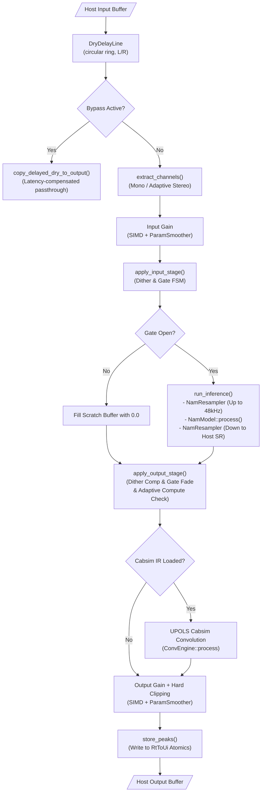

<!--
SPDX-License-Identifier: GPL-3.0-or-later
Copyright (c) 2026 Fábio Henrique de Lima Silva (fhl.bsb@gmail.com) All rights reserved.
-->

# NAM-Plug Architecture: CLAP Plugin

This document is the primary architecture reference and source of truth for **NAM-Plug**, a Neural Amp Modeler (NAM) audio plugin built on the CLAP (CLever Audio Plug-in) specification for Linux.

NAM-Plug wraps the low-latency DSP neural inference engine provided by the [`NeuralAmpModeler-rs`](https://github.com/fabiohl/NeuralAmpModeler-rs) library crate into a production-grade CLAP plugin. It manages plugin lifecycle, DAW parameter automation, lock-free real-time audio processing, state persistence, host extension compliance, and an immediate-mode graphical user interface.

> **Scope Boundary:** For microarchitectural details on neural model execution (WaveNet, LSTM, ConvNet, Linear), SIMD kernels (AVX2 `x86-64-v3`), polyphase resamplers, half-band FIR filters, or model loading formats (`.nam`/`.namb`), see the core engine documentation in [`NeuralAmpModeler-rs`](https://github.com/fabiohl/NeuralAmpModeler-rs) (`docs/architecture.md`).

---

## 1. System Topology & Thread Model

NAM-Plug enforces strict thread segregation to guarantee Real-Time (RT) safety during audio processing while providing responsive UI rendering and host DAW coordination.

```text
┌─────────────────────────────────────────────────────────────────────────────┐
│                            DAW Host Environment                             │
└──────┬──────────────────────────────────┬───────────────────────────┬───────┘
       │ (C-ABI Extensions)               │ (process() Callback)      │ (Host Window)
       ▼                                  ▼                           ▼
┌─────────────────────────────┐  ┌─────────────────────────┐  ┌────────────────────────┐
│        Main Thread          │  │    Audio Thread (RT)    │  │       GUI Thread       │
│  - Plugin Lifecycle         │  │  - Hard RT Contract     │  │  - Slint Event Loop    │
│  - Parameter Scanning       │  │  - Zero Heap Alloc      │  │  - "nam-slint-gui"     │
│  - State Save / Load        │  │  - Zero Mutex Locks     │  │  - Slint v1.18 FemtoVG │
│  - nam-model-loader Offload │  │  - Zero Blocking I/O    │  │  - Wayland & X11       │
│  - GC Tier 1 Disposal       │  │  - DSP Signal Chain     │  │  - Async rfd FileDialog│
│                             │  │                         │  │  - 5-Zone UI Layout    │
└──────────────┬──────────────┘  └────────────▲────────────┘  └───────────┬────────────┘
               │                              │                           │
               │ SPSC Command Queues          │ Atomics & Peak Telemetry  │
               └──────────────────────────────┴───────────────────────────┘
```

### 1.1 Thread Roles & Hard Contracts

- **Main Thread (Host):**

  - **Lifecycle & State:** Handles plugin lifecycle (`init`, `activate`, `deactivate`, `destroy`), parameter scanning, and DAW project state serialization/restoration (`clap_plugin_state`).
  - **Worker Offloading:** Dispatches asynchronous `.nam`/`.namb` model loading to `"nam-model-loader"` and CabSim IR reading via `cabsim::loader`.
  - **Garbage Collection:** Drains the Tier 1 SPSC deallocation queue (`gc_tx`).
  - **Autonomous Housekeeping:** When `clap_plugin_timer_support` is available, registers a periodic 250 ms watchdog timer with the host. This timer executes `housekeeping()` (recovering poisoned RT processors via `request_restart()`, announcing dynamic PDC latency changes via `HostLatency::changed()`, and draining GC queues) independently of GUI events. Falls back to event-driven housekeeping on hosts without timer support.

- **Audio Thread (RT):**

  - Driven exclusively by the host `process()` callback (`PluginAudioProcessor::process` in `src/clap/processor/mod.rs`).

  > [!IMPORTANT]
  > **Hard Real-Time Contract:** Zero heap allocations, zero mutex locks, zero blocking I/O, zero panics. Operates directly on host audio buffers using host-driven single-callback processing.

- **GUI Thread:**

  - Dedicated `"nam-slint-gui"` event loop thread running `slint::run_event_loop()` with Slint 1.18 (FemtoVG / winit backend).
  - Fully isolated from the audio thread, synchronizing peak telemetry, DSP load, and parameter changes at 60 Hz via `SlintViewModel`.

### 1.2 Host vs. Plugin Real-Time Boundary & `rt-hardening` Delegation

The underlying DSP engine (`NeuralAmpModeler-rs`) provides an optional `rt-hardening` feature with Linux system utilities for memory locking (`mlockall`), thread scheduling (`SCHED_FIFO`), CPU core affinity, and PM-QoS (`/dev/cpu_dma_latency`).

**Architectural Decision:** `NAM-Plug` **strictly disables** `rt-hardening`. Process-level real-time hardening is the exclusive responsibility of the DAW host:

1. **Address Space Isolation (`mlockall`):** As a dynamic shared library (`cdylib`), calling `mlockall(MCL_CURRENT | MCL_FUTURE)` from inside a plugin would lock all virtual pages belonging to the host and sibling plugins, risking immediate `ENOMEM` in production sessions with large sample libraries.
2. **Thread Scheduling & Affinity (`sched_setscheduler`, `pthread_setaffinity_np`):** Audio threads are created and scheduled by the DAW host. Forcing `SCHED_FIFO` or thread pinning from within a plugin disrupts host multicore load-balancing and violates the CLAP specification.
3. **Global System Resources (`PM-QoS`):** `/dev/cpu_dma_latency` is a system-wide resource; individual plugins must not contend for global DMA latency locks.

**Local RT Safety Invariants:** While delegating host-level thread policy to the DAW, `NAM-Plug` enforces strict real-time discipline internally:

- **Thread-Local FTZ / DAZ:** Configured on the audio thread upon first execution (`_MM_SET_FLUSH_ZERO_MODE` / `_MM_SET_DENORMALS_ZERO_MODE`) via thread-local SSE control registers without modifying global host state.
- **Strict Audio Callback Contract:** Zero heap allocations (enforced via `heap-audit`), zero mutex locks, zero blocking I/O, and zero panics.
- **Passive RT Telemetry:** Thread scheduling, CPU affinity, and processing health are passively reported through lock-free atomic bitmasks (`RtStatusFlags`).

---

## 2. Compilation Strategy & Feature Flags

`NAM-Plug` compiles into a dynamic shared library (`libnam_plug.so`, installed as `nam_plug.clap`) and auxiliary testing binaries (`pgo_profiling_workload` and `nam_perf_guard` under `src/bin/`, gated behind `testing`). Standalone PipeWire hosting is handled separately by `NAM-Audio-Pipe`.

| Feature Flag | Default | Description                                                                                                                    |
|:------------ |:------- |:------------------------------------------------------------------------------------------------------------------------------ |
| `dual-mono`  | Yes     | Enables two independent, identical L/R inference chains with zero channel crosstalk, plus dynamic adaptive stereo VU metering. |
| `testing`    | No      | Enables internal test harnesses, fixture resolution, `nam_perf_guard`, and `pgo_profiling_workload`.                           |
| `heap-audit` | No      | Activates the global allocation counting allocator (`CountingAllocator`) for RT-safety verification.                           |

```bash
# Standard release build (produces target/release/libnam_plug.so)
cargo build --release

# Development build with testing harness
cargo build --features testing
```

### 2.1 Link-Time Symbol Hardening & ELF Interposition Defense

To prevent fatal runtime CPU spin loops in Linux release builds caused by dynamic linker (`ld.so`) symbol interposition:

- **The ELF Interposition Hazard:** When third-party dependencies define bare C-ABI fallback routines for standard math functions (`log10f`, `atan2f`, `acosf`, etc.) with global visibility, `ld.so` resolves dynamic `JUMP_SLOT` relocations back to the local plugin binary instead of system `libm.so.6`. This creates a self-referential `trampoline -> PLT -> GOT -> trampoline` infinite loop (100% CPU spin, zero syscalls).
- **Hardening Guard (`build.rs`):** `NAM-Plug` links all binaries and the CLAP `cdylib` with a linker version script ([`.cargo/hide-libm-shadow.map`](../.cargo/hide-libm-shadow.map)) via `-Wl,--version-script=...` and `-Wl,--undefined-version`. This demotes shadowed `libm` symbols to `local` binding, ensuring dynamic calls resolve strictly to the system's `libm.so.6`.
- **Reference:** For the in-depth disassembly trace and relocation analysis, see [`NeuralAmpModeler-rs/docs/postmortem-libm-symbol-interposition.md`](https://github.com/fabiohl/NeuralAmpModeler-rs/blob/main/docs/postmortem-libm-symbol-interposition.md).

---

## 3. Plugin Descriptor & Parameter Surface

### 3.1 Plugin Descriptor

Returned by `nam_descriptor()` (`src/clap/descriptor.rs`) during host scan without heap allocation:

| Field        | Value                                                              |
|:------------ |:------------------------------------------------------------------ |
| **ID**       | `br.eti.fabiolima.nam-plug`                                        |
| **Name**     | `NAM-Plug`                                                         |
| **Vendor**   | `Fabio Lima`                                                       |
| **URL**      | `https://github.com/fabiohl/NAM-Plug`                              |
| **Features** | `["audio-effect", "distortion", "gate", "mono"]` (CLAP 1.2.2 spec) |

Core DSP neural inference is mono by definition. Buffer extraction and VU metering adapt dynamically to mono or stereo host track configurations.

### 3.2 Parameter Surface Catalog

Exposed via `src/clap/extensions/params/` and synchronized via `src/clap/processor/params.rs` (using engine parameters from `RtProcessingParams`). Parameter IDs are `u32` constants (`PARAM_*`, 0–8):

| Parameter                | ID                         | Type    | Range / Options                                                 | Description                                                |
|:------------------------ |:-------------------------- |:------- |:--------------------------------------------------------------- |:---------------------------------------------------------- |
| **Input Gain**           | `input_gain_db` (0)        | dB      | `-20.0` to `+20.0` (default `0.0`)                              | Pre-inference gain, sample-accurate smoothed.              |
| **Output Gain**          | `output_gain_db` (1)       | dB      | `-20.0` to `+20.0` (default `0.0`)                              | Post-inference gain, sample-accurate smoothed.             |
| **Gate Threshold**       | `gate_threshold_db` (2)    | dB      | `-90.0` to `-40.0` (default `-90.0`, off by default)            | Noise-gate opening threshold.                              |
| **Bypass**               | `bypass` (3)               | Binary  | `0.0` (false / default) / `1.0` (true)                          | Disables neural processing (32 ms crossfaded passthrough). |
| **Active Model**         | `active_model` (4)         | String  | `0.0` to `1000.0` (Read-only, default `0.0`)                    | Filename / identification of currently loaded model.       |
| **Adaptive Compute**     | `adaptive_compute` (5)     | Stepped | `0` (`Off`), `1` (`Conservative` / default), `2` (`Aggressive`) | CPU-based dynamic degradation FSM.                         |
| **Slim Override**        | `slim_override` (6)        | Stepped | `0` (`Auto` / default), `1` (`ForceFull`), `2` (`ForceLite`)    | Slimmable A2 container submodel selection.                 |
| **Oversampling**         | `oversample` (7)           | Stepped | `0` (`Off` / default), `1` (`2x`), `2` (`4x`)                   | Activation oversampling factor.                            |
| **Activation Precision** | `activation_precision` (8) | Stepped | `0` (`Fast`), `1` (`Standard` / universal default)              | Math mode (`Standard` exact / `Fast` Padé-minimax).        |

Model file paths (`.nam`/`.namb`) and CabSim IR file paths (`.wav`) are managed as **DAW State Properties** (`clap_plugin_state`), enabling project-level serialization and restoration.

### 3.3 Mandatory Asset Identity (SHA-256)

Every asset reference persisted in state **must** carry its SHA-256 hex digest (`model_hash` / `ir_hash`, exactly 64 characters) — representing the content-based portable identity of the file.

> **Asset Verification Invariant:** No asset is adopted without a valid digest verified in the same restore cycle, preventing silent corruption across different machines.

| Path Context                           | Verification Policy                                                                                                                                                                                                                                                                                                                                                 |
|:-------------------------------------- |:------------------------------------------------------------------------------------------------------------------------------------------------------------------------------------------------------------------------------------------------------------------------------------------------------------------------------------------------------------------- |
| **Full Restore** (Project / Duplicate) | If `model_path` exists, the digest is mandatory and must match the file at restore time. A missing, malformed, or divergent digest rejects that path. The basename fallback executes only when the expected digest exists and matches a candidate. Full state without an expected digest results in an explicit failure — leaving the previously active DSP intact. |
| **Basename Search** (Cross-Machine)    | A candidate file is adopted only when its computed digest equals the saved `model_hash`. A reference without a saved hash is rejected outright.                                                                                                                                                                                                                     |
| **CabSim IR**                          | The same rule applies: an `ir_path` without a matching `ir_hash` never loads the WAV file.                                                                                                                                                                                                                                                                          |
| **Legacy Presets (No Hash)**           | Rejected during automatic restore. Users migrate presets via the explicit GUI action — loading the model/IR file via the dialog recomputes the digest and saves an updated preset.                                                                                                                                                                                  |
| **State Save**                         | `state.save` and `state-context.save` refuse to persist any asset reference lacking a well-formed digest.                                                                                                                                                                                                                                                           |

All adoption paths compute the digest up-front and **fail closed** if it cannot be computed (e.g., file exceeding the 256 MiB streaming-hash limit). An asset without a digest is never adopted and never persisted.

---

## 4. CLAP Extensions Framework

Extensions are registered in `declare_extensions()` (`src/clap/plugin/mod.rs`) via `clack-extensions`:

| Extension                            | Reference File                                  | Purpose                                                                                     |
|:------------------------------------ |:----------------------------------------------- |:------------------------------------------------------------------------------------------- |
| `clap_plugin_audio_ports`            | `src/clap/extensions/audio_ports.rs`            | Mono input/output audio ports, in-place processing pair enabled.                            |
| `clap_plugin_audio_ports_activation` | `src/clap/extensions/audio_ports_activation.rs` | Dynamic channel deactivation (e.g., right channel on mono tracks) saving gain/copy compute. |
| `clap_plugin_params`                 | `src/clap/extensions/params/`                   | Parameter mapping, DAW automation, gesture tracking, and `flush()`.                         |
| `clap_plugin_state`                  | `src/clap/extensions/state.rs`                  | DAW project state serialization (parameters + model path + IR path).                        |
| `clap_plugin_state_context`          | `src/clap/extensions/state_context.rs`          | Context-aware state restore (distinguishes portable presets vs. project duplicates).        |
| `clap_plugin_latency`                | `src/clap/extensions/latency.rs`                | Dynamic latency reporting (resampler + oversample + CabSim total delay).                    |
| `clap_plugin_track_info`             | `src/clap/extensions/track_info.rs`             | Host track color synchronization to GUI accent theme.                                       |
| `clap_plugin_remote_controls`        | `src/clap/extensions/remote_controls.rs`        | "Main" and "Gate" control pages for hardware controllers / DAW device panels.               |
| `clap_plugin_param_indication`       | `src/clap/extensions/param_indication.rs`       | GUI visual cues for mapped/automated/overridden parameter status.                           |
| `clap_plugin_preset_load`            | `src/clap/extensions/preset_load.rs`            | Direct model loading (`.nam`/`.namb`) from host preset browser.                             |
| `clap_plugin_render`                 | `src/clap/extensions/render.rs`                 | Offline render detection. Forces `AdaptiveCompute::Off` + `Standard` activation precision.  |
| `clap_plugin_tail`                   | `src/clap/extensions/tail.rs`                   | Host tail query reporting remaining CabSim IR ring-out frames.                              |
| `clap_plugin_timer_support`          | `src/clap/extensions/timer.rs`                  | Periodic 250 ms watchdog timer driving autonomous housekeeping and RT recovery.             |
| `clap_plugin_gui`                    | `src/clap/extensions/gui.rs`                    | Hardware-accelerated Slint GUI with native X11 XEmbed embedding and floating fallback.      |

### 4.1 Windowing Support Matrix

| Negotiation (`is_floating`)         | Wayland Session (`WAYLAND_DISPLAY`)                                                                | X11 Session / XWayland                                       |
|:----------------------------------- |:-------------------------------------------------------------------------------------------------- |:------------------------------------------------------------ |
| `CLAP_WINDOW_API_X11`, **embedded** | `create` rejected unless `DISPLAY` reachable (XWayland); forces X11 loop → **Native XEmbed child** | **Native XEmbed child** of the host `Window` (preferred API) |
| `CLAP_WINDOW_API_X11`, floating     | X11 floating window via XWayland                                                                   | Plugin-owned top-level X11 window                            |
| `CLAP_WINDOW_API_WAYLAND`, floating | Native Wayland top-level window (preferred API)                                                    | Wayland window if compositor is present; else rejected       |
| `CLAP_WINDOW_API_WAYLAND`, embedded | **Rejected** (no XEmbed equivalent on Wayland per CLAP spec)                                       | **Rejected**                                                 |

**Guarantees:**

- An embedded request is honored **only** when true embedding succeeds (create-time viability gate + strict `set_parent` error path). The plugin never silently delivers a floating window for an embedded request and never creates two windows.
- Repeated `create`/`destroy` cycles reuse the persistent per-instance GUI worker.

---

## 5. Lock-Free Communication & RT Safety Architecture

Shared cross-thread state is anchored in `NamClapShared` (`src/clap/plugin/shared.rs`). The audio thread hot path uses **zero mutexes, zero locks, and zero allocations**, relying on atomic primitives and lock-free SPSC channels (`rtrb`).

```text
┌─────────────────────────────────────────────────────────────────────────────┐
│                          NamClapShared Allocation                           │
├─────────────────────────────────────────────────────────────────────────────┤
│  #[repr(align(128))] RtToUi      (RT Thread -> UI Reads)                    │
│    - ui_peak_l / ui_peak_r, ui_clipped, active_channel_count, latency       │
├─────────────────────────────────────────────────────────────────────────────┤
│  #[repr(align(128))] UiToRt      (UI Thread -> RT Reads)                    │
│    - 8 Parameter Atomics, gesture_flags, gui_param_generation               │
├─────────────────────────────────────────────────────────────────────────────┤
│  #[repr(align(128))] ColdShared  (Main / UI / RT Setup)                     │
│    - SPSC Command Queues, pending_model payload, IR state, alive_fence      │
└─────────────────────────────────────────────────────────────────────────────┘
```

### 5.1 Cache-Line Isolation (`#[repr(align(128))]`)

To eliminate CPU cache bouncing (False Sharing) between the high-frequency audio thread and the UI/Main threads:

- **`RtToUi`** — Dedicated 128-byte aligned cache line for telemetry communicated from RT to UI (`ui_peak_l`, `ui_peak_r`, `ui_clipped`, `ui_clip_indicator`, `ui_gate_active`, `current_latency`, `cabsim_tail_samples`, `active_channel_count`).
  - Peak levels are accumulated across audio blocks by RT via `AtomicU32::fetch_max` and read/cleared by UI via `swap(0.0f32.to_bits())` without TOCTOU races.
  - The `ui_clipped` sticky flag is set by RT and cleared by UI upon acknowledgement.
- **`UiToRt`** — Dedicated 128-byte aligned cache line for parameters written by UI (`input_gain_db`, `output_gain_db`, etc.) and the `gui_param_generation` counter.
- **`ColdShared`** — Dedicated 128-byte aligned structure for low-frequency channels and lifecycle flags (`alive_fence`, pending payloads).

### 5.2 Generation-Counter Parameter Synchronization

To prevent loading 8 atomic floats on every audio block when parameters are stationary:

1. UI/Main updates parameter atomics and executes `fetch_add(1, Release)` on `gui_param_generation`.
2. Audio thread performs a single `Acquire` load of `gui_param_generation`. If unchanged, per-parameter reads are skipped. If incremented, it reads parameter targets with `Relaxed` ordering and passes them to `ParamSmoother`.

### 5.3 Three-Tier Real-Time Garbage Collection Cascade

Deallocating complex DSP structures (`Box<StaticModel>`, `Box<NamResampler>`, `ConvEngine`, `OversampleEngine`) on the audio thread causes allocator locks and priority inversion. Disposal cascades through three lock-free tiers (`gc_cascade` in `neural_amp_modeler_rs::common::spsc::gc`):

```text
RT Thread (Replaced Asset)
       │
       ▼
[Tier 1: SPSC gc_tx (32 slots)] ──────► Drained by Main Thread (housekeeping)
       │ (if full)
       ▼
[Tier 2: Processor Parking Lot (16 slots)] ──► Flushed back to SPSC next block;
       │                                          single-owner handoff on deactivate
       │ (if full)
       ▼
[Tier 3: GcOverflowBuffer Atomic Ring] ────► Controlled Leak + Sets RT_STATUS_GC_OVERFLOW
```

1. **Tier 1 (SPSC GC Queue):** Push to `gc_tx` (32 slots). The main thread drains and drops objects during periodic `housekeeping()`.
2. **Tier 2 (Processor Parking Lot):** Fixed array `[Option<GcItem>; 16]` inside `PluginAudioProcessor`. Flushed back to SPSC whenever capacity frees. At plugin teardown, `deactivate()` passes `&mut parking_lot` to `drain_gc_final()` for single-owner disposal on the main thread.
3. **Tier 3 (`GcOverflowBuffer`):** Atomic ring buffer. Overwrites the oldest slot if completely saturated, setting `RT_STATUS_GC_OVERFLOW` to preserve hard real-time deadlines.

### 5.4 Poison-Resilient Activation Rollback Guard (`ActivateRollbackGuard`)

During plugin `activate()`, channel receivers (`param_rx`, `slimmable_rx`), `gc_tx`, and `deactivated_dsp` are transferred to the audio processor under `ActivateRollbackGuard` (`src/clap/processor/rollback.rs`). If activation panics or fails midway, `Drop` recovers poisoned mutexes and restores all resources back into `ColdShared` without dropping them on the audio thread.

### 5.5 Cold-Path Latency Caching (`cached_effective_latency`)

Recomputing effective latency (resampler latency + oversample latency + CabSim IR latency) requires arithmetic and multiple structure queries. Effective latency is cached in `cached_effective_latency` (`src/clap/processor/state.rs`) and recomputed strictly during cold swap routines (`cold_load_model`, `cold_load_cabsim`, `apply_oversample`), eliminating latency math from the hot `process_events` path while driving instant PDC updates via `clap_plugin_latency`.

### 5.6 FFI Lifetime Safety, Panic Guard & Multi-Instance Isolation

- **Refcounted Shared State (`Arc<GuiSharedState>`):** `NamClapShared` owns plugin shared state through `Arc<GuiSharedState>` (`src/clap/plugin/shared.rs`). Windows, background file pickers, and teardown reaper threads all hold refcounted references, preventing use-after-free conditions.
- **Logical Validity Gate (`alive_fence`):** An `Arc<AtomicBool>` lowered in `NamClapShared::drop`. During teardown, the main thread lowers the fence and joins background threads before releasing state. Callbacks gated by the fence become no-ops, preventing callbacks to the host after `destroy()`.
- **Safe Host Bridge (`GuiHostBridge`):** Stores the raw host pointer as `NonNull<()>` and reconstructs `HostSharedHandle<'static>` on demand, reflecting the CLAP guarantee that the host outlives the plugin.
- **C-ABI Panic Guard & Processor Poisoning Latch:** All CLAP entry points wrap execution in `catch_unwind(AssertUnwindSafe(..))`. If a panic occurs on the audio thread:
  1. The panic payload is dropped without allocation (`panic_to_error` uses static catalog messages).
  2. The processor latches `self.poisoned = true`, zeroes output audio ports, and asserts `RT_STATUS_PROCESSOR_POISONED`.
  3. Subsequent audio blocks execute an $O(1)$ containment branch, maintaining silence and returning `Ok(ProcessStatus::Continue)` without allocations or I/O, preventing panic cascades and acoustic spikes.
  4. Off-RT, the main thread detects the poisoned bit during `housekeeping()` and triggers `host.request_restart()`.
  5. Upon `deactivate()`, corrupted DSP state is discarded (`deactivated_dsp = None`). Subsequent activation cleanly resumes processing.
- **Multi-Instance Isolation:** Every instance receives a unique `instance_id` (`next_instance_id()`). Diagnostics and logging sinks are scoped per instance, preventing crosstalk in multi-track DAW sessions.

### 5.7 Deferred Model Load (`pending_model`)

When DAW state is restored prior to `activate()`, the host buffer size (`max_frames_count`) is unknown. The model payload is cached in `ColdShared::pending_model` and flushed via `flush_pending_model()` during `activate()` or initial `housekeeping()`.

**UI Synchronization Invariant:**

- `commit_prepared_model` publishes identity (`params.model_path/hash`) up-front, but display telemetry (`ui_model_metadata`, `ui_model_name`, `model_load_counter`, and error clearing) lands together in `finish_commit_ui`. The UI advances only after the model is retained.
- `flush_pending_model` uses an RAII restore guard: any error re-inserts the model into `pending_model` for retry instead of dropping it, setting `RT_STATUS_MODEL_LOAD_FAILED` and populating `ui_load_error_msg`.

### 5.8 Channel Preservation on `deactivate()`

Calling `deactivate()` returns SPSC channel consumers (`param_rx`, `gc_tx`, `slimmable_rx`) back into `ColdShared`, allowing hosts to stop and restart audio processing without reconstructing channels or reallocating memory.

### 5.9 Transactional State Restore (Stage / Commit / Ack)

State restoration (`clap_plugin_state`, `clap_plugin_state_context`, and preset loading) follows a 3-phase **Stage → Commit → Ack** protocol ensuring atomic transitions where no observer ever sees a hybrid of two restore generations:

1. **Stage:** `build_restore_package()` validates asset digests, resampler feasibility, and parameter subsets. Heavy resources (model, IR adapter) are moved **by value** into the transaction without modifying active DSP state.
2. **Commit (RT):** The package is pushed as a single `ClapParamPayload::RestoreTxn` item into the SPSC command ring. The audio thread applies model, IR, and parameters atomically in a single audio block without heap allocation.
3. **Ack:** Once the audio thread acknowledges the sequence number (`is_acked(seq)`), `publish_restore()` updates UI metadata, parameter atomics, and host state flags. UI and disk observe the new state only after the audio thread has committed it.

---

## 6. DAW Audio Processing & DSP Pipeline

The audio thread entry point `PluginAudioProcessor::process()` (`src/clap/processor/mod.rs`) executes the signal chain:



### 6.1 Execution Sequence

1. **Subnormal & Denormal Setup:** First block enables Flush-To-Zero (FTZ) and Denormals-Are-Zero (DAZ) via SSE control registers.
2. **Event & Command Draining (`process_events()`):** Drains command and slimmable rings via `RtSwapDrain` schedulers (at most one structural swap per callback), then updates local parameter targets from GUI atomics.
3. **Channel Extraction (`extract_channels()`):** Maps host input buffers into contiguous working scratch buffers and detects active channel count (`1` or `2`) for adaptive metering.
4. **Input Gain & Stage:** Applies user input gain (SIMD + `ParamSmoother`), injects anti-subnormal dither (`-220 dBFS`), and evaluates the Noise Gate FSM.
5. **Neural Inference (`run_inference()`):**
   - Upsamples host sample rate to native 48 kHz via minimum-phase polyphase `NamResampler` (bypassed if host rate is 48 kHz).
   - Runs `NamModel::process()` (with optional 2x/4x oversampling around neural activations).
   - Downsamples 48 kHz back to host sample rate.
6. **Output Stage & Degradation Check:** Compensates dither, applies linear gate fade ramps, and checks block deadlines for `AdaptiveCompute` CPU fallback.
7. **CabSim IR Stage (Optional):** Runs Uniform-Partitioned Overlap-Save (UPOLS) frequency-domain convolution (`ConvEngine::process()`) if an IR is loaded.
8. **Output Gain & Clipping:** Applies output gain (SIMD + `ParamSmoother`), enforces hard clipping at `+0 dBFS` if configured, and updates peak telemetry atomics.

### 6.2 Branchless FMA Bypass Crossfader (`process_crossfade_sub_block`)

To prevent clicks, pops, or phase artifacts when toggling plugin bypass:

- **Branchless Scalar FMA Loop:** The inner blend loop executes across `n_xfade` samples without internal branching (`wet[i] = dry[i] + (wet[i] - dry[i]) * mix`) using scalar FMA instructions. Under strict IEEE-754 semantics (avoiding non-compliant fast-math), scalar recurrence guarantees deterministic transitions.
- **Mix Clamping:** Mix parameters are clamped to `[0.0, 1.0]` at each step, preventing saturation artifacts.

#### 6.2.1 Latency-Compensated Dry Path (`DryDelayLine`)

The wet DSP chain introduces algorithmic latency (`cached_effective_latency` = resampler delay + oversampling filter delay + CabSim partition delay). The dry path is latency-compensated to match this delay exactly:

- **Pre-allocated Circular Ring:** `DryDelayLine` (`src/clap/processor/dsp/dry_delay.rs`) wraps two engine `DelayLine<f32>` rings allocated once in `activate()`.
- **Single Dry Source:** `process_sub_block` feeds raw host input into the ring every sub-block. Both the bypass output (`copy_delayed_dry_to_output`) and the crossfade blend consume this compensated dry signal, preventing phase cancellation and comb filtering.
- **Seamless Host PDC:** In the bypassed state, the output is delayed by the exact declared latency, ensuring host Plugin Delay Compensation (PDC) remains aligned without temporal jumps.

### 6.3 Model Gain Calibration Isolation

NAM models supply embedded metadata (`input_level_dbu`, `loudness`). Calibration adjustments (`input_mult_adj`, `output_mult_adj`) are passed separately via `DspPipelineContext` rather than multiplying user gain smoothers, ensuring DAW parameter automation never alters intrinsic model calibration.

### 6.4 Host Event Scheduling, In-Block Slicing & Anomaly Containment

Host parameter automation and modulation events are processed in `src/clap/processor/dsp/orchestrator.rs`:

1. **Bounded Event Buffer (`MAX_SCHEDULED_EVENTS`):** Input events are parsed into a pre-allocated buffer of 4096 entries. Floods exceeding capacity are truncated, asserting `RT_STATUS_SPSC_DRAIN_TRUNCATED` for off-RT logging.
2. **Sample-Accurate Sub-Block Slicing:** The block is partitioned into consecutive slices bounded by distinct event timestamps (`sub_end = scheduled_events[event_idx].time`). Sliced audio is processed through the DSP chain, events are applied at slice boundaries, and smoothers resynchronize.
3. **Temporal Anomaly Policy:**
   - **Jittered Events (`time < block_offset`):** Clamped to `block_offset` and applied immediately before subsequent DSP processing.
   - **Out-of-Bounds Events (`time >= n_samples`):** Clamped to `n_samples` and applied at the block close boundary, guaranteeing parameter values are never lost.
   - **Telemetry:** Timing anomalies assert `RT_STATUS_EVENT_TIMING_ANOMALY` for off-RT diagnostic reporting via `log::warn!`.

### 6.5 Two-Phase Non-Finite Containment

Non-finite (NaN/Inf) host input samples poison recurrent neural network states. To contain poisoning without synchronous multi-millisecond resets:

1. **Detection:** Input stage detects non-finite samples and asserts `RT_STATUS_NON_FINITE_INPUT_DETECTED`.
2. **Fast Containment (O(1)):** At the start of the audio block, `NamModel::prewarm_reset()` restores model state without synchronous stabilization loops. Delay lines and parameter smoothers snap to target, clearing pre-fault history.
3. **Held Dry Block:** The faulted callback outputs latency-compensated dry audio (`process_dry_contained_block`) while the model reconverges over an amortized window, avoiding heavy blocking resets (1.8–4.2 ms) on the audio thread.

### 6.6 Transparent Oversize Block Slicing

When DAW hosts deliver audio buffers exceeding internal design limits (`n_samples > MAX_RESAMP_BUF`, where `MAX_RESAMP_BUF = 2048` frames):

1. **Cold Path Chunking:** `process_sub_block` branches via `cold_path()` to `process_sub_block_chunked`.
2. **Zero-Allocation Slicing:** Partitions the oversize block into successive slices of at most 2048 frames using pre-allocated scratch buffers (`SubBlockScratch`).
3. **DSP Continuity:** All stateful components (delay rings, crossfaders, smoothers, resamplers, CabSim partitions) advance continuously across slices without boundary clicks or state resets.

---

## 7. Graphical User Interface (Slint GUI Architecture)

The graphical interface is built using Slint (v1.18) under `src/clap/gui/`.

```text
┌─────────────────────────────────────────────────────────────────────────────┐
│                       NAM-Plug Slint GUI Architecture                       │
├─────────────────────────────────────────────────────────────────────────────┤
│  5-Zone UI Layout (main.slint)                                              │
│    Zone 1: Identity Bar (Brand, ModelCard, IrCard, Load Buttons, Alerts)   │
│    Zone 2: Controls Grid (Input/Output Gain, Gate, Oversample, Precision)   │
│    Zone 3: Meters Section (Adaptive VuMeter: Mono / Stereo with IEC PPM)    │
│    Zone 4: Bypass Toggle (ToggleSwitch with active glow & crossfade sync)   │
│    Zone 5: Status Bar (Sample Rate, Latency, DSP Load, Backend, SIMD)       │
├─────────────────────────────────────────────────────────────────────────────┤
│  Rendering Pipeline: Slint v1.18 ──► FemtoVG / OpenGL backend via winit     │
├─────────────────────────────────────────────────────────────────────────────┤
│  Windowing: X11 embedded (native XEmbed) + X11/Wayland floating fallback    │
│             Persistent per-instance GUI worker + bounded teardown reaper    │
├─────────────────────────────────────────────────────────────────────────────┤
│  Async File Picker: rfd (Background Worker File Dialog, Non-Blocking)       │
└─────────────────────────────────────────────────────────────────────────────┘
```

### 7.1 Module Organization

- `src/clap/gui/mod.rs` — GUI entry point, default window dimensions (`600x275`), and `GuiHostBridge`.
- `src/clap/gui/worker.rs` — Persistent per-instance GUI worker thread (`GuiWorker`) owning the Slint platform and event loop.
- `src/clap/gui/x11_embed.rs` — X11 XEmbed embed-at-creation engine and backend selection hooks.
- `src/clap/gui/lifecycle.rs` — `GuiLifecycle` finite state machine for window visibility.
- `src/clap/gui/slint/main.slint` — Declarative 5-Zone UI layout (`MainWindow`).
- `src/clap/gui/slint/` — Modular Slint components (`RotaryKnob`, `VuMeter`, `ToggleSwitch`, `ModelCard`, `IrCard`).
- `src/clap/gui/slint_view_model.rs` — `SlintViewModel`: bridges Slint properties with plugin atomics, drives 60 Hz polling, and applies IEC 60268-10 ballistics.
- `src/clap/gui/file_dialogs.rs` — Asynchronous background file pickers using `rfd::AsyncFileDialog`.
- `src/clap/gui/dialog_state.rs` — Lock-free state synchronization for file dialogs.
- `src/bin/ui_preview.rs` — Standalone binary for rapid visual inspection without a DAW host.

### 7.2 Telemetry Synchronization & IEC 60268-10 Ballistics

- A dedicated 60 Hz Slint timer polls atomic telemetry from `NamClapShared::rt_to_ui`.
- Peak levels follow standard IEC 60268-10 Type I (DIN) ballistics:
  - **Attack:** Immediate (single-block peak capture).
  - **Decay:** 1700 ms fallback to -20 dBFS.
  - **Peak-Hold Indicator:** 1.5-second retention before release.
- **Adaptive Track Configuration:** Adapts automatically between a centered mono bar and independent stereo L/R bars based on `active_channel_count`.

#### 7.2.1 Status-Bar Badges

- **`model_arch` (Live):** Displays loaded model architecture (e.g., WaveNet A1, LSTM) from `ui_model_metadata`. Shows `"No model loaded"` when inactive.
- **`simd_badge` (Static):** Displays detected SIMD baseline (`"AVX2+FMA"`), evaluated once per window creation.
- **`backend_text` (Static):** Displays active window backend (`"X11 (Embedded)"`, `"X11 (Floating)"`, `"Wayland (Floating)"`).
- **`dsp_load_text` (Live):** Formatted as `"{pct}% DSP"` from `rt_to_ui.dsp_load_permille`, with a 2-second peak-hold alert indicator for audio dropouts (XRUNs).

#### 7.2.2 Status Alert Banner

Operational warnings are derived off-RT from `ColdShared::ui_alert_bits` and displayed as status bar pills with tooltips:

- Captures processor poisoning, host contract violations, CabSim errors, resampler rebuild failures, dynamic CPU degradation, and non-finite input events (3-second hold).

### 7.3 Persistent GUI Worker & Bounded Teardown (`nam-gui-reaper`)

**Thread-Pinning Rationale:** Slint 1.18 binds its platform, event loop, and window hooks to the thread that first initializes it. Creating a new thread per window open/close cycle causes `SetPlatformError`. NAM-Plug therefore runs **one** persistent `"nam-slint-gui"` thread per plugin instance.

**Teardown Protocol:**

1. The host invokes `gui.destroy()` or the user closes the window.
2. The plugin closes the window (`slint::quit_event_loop()`), while the worker thread remains alive for subsequent `create()` calls.
3. The worker releases UI components and executes one drained loop iteration to ensure winit's queued `XDestroyWindow` reaches the X server, preventing orphan windows.
4. Upon **instance destruction**, the worker is joined with a bounded 2000 ms timeout. If the window backend delays release, the handle is handed off to a detached background thread (`"nam-gui-reaper"`), ensuring the DAW main thread is never blocked.

### 7.4 Asynchronous Model Loader (`nam-model-loader`)

Model loading is divided into two phases:

1. **Prepare Phase (Off-RT):** File reading, JSON parsing, SHA-256 calculation, and model/resampler instantiation execute on a dedicated background thread (`"nam-model-loader"`).
2. **Commit Phase (Main Thread):** The completed result is swapped atomically on the main thread and pushed to the audio thread via SPSC command queues.

- **Adaptive Structural Rebuild Offload:** The model loader also offloads allocation-heavy tasks for the audio thread, including WaveNet slimmable slices and oversampling engine rebuilds. The main thread's housekeeping watchdog accelerates from 250 ms to 50 ms while a rebuild is pending.

### 7.5 GUI Lifecycle State Machine

Window visibility is governed by `GuiLifecycle` (`Hidden → ShowRequested → Active → HideRequested → Hidden`):

- **Host-driven:** `create()`, `show()`, and `hide()` initiate state transitions on the main thread.
- **Backend-driven:** The GUI worker notifies the main thread upon window readiness (`WindowReady`) or user closure (`gui_user_closed`), advancing the state machine off-RT.

### 7.7 X11 Embedding Architecture

NAM-Plug supports native X11 window embedding (XEmbed) under Linux using Slint's `with_winit_window_attributes_hook` (`unstable-winit-030` feature).

**Architectural Decision: Embed-at-Creation:**

- **Mechanism:** Before creating the window, `BackendSelector` registers a hook that applies `.with_embed_parent_window(parent_id)`. Winit creates the window as a direct child of the host window and sets the `_XEMBED` property at creation time.
- **Alternative Rationale:**
  - *Reparent-after-creation (Rejected):* Reparenting after mapping causes race conditions with Window Managers and requires an external X11 connection.
  - *Custom WindowAdapter (Rejected):* Re-implements complex window management already handled by Slint.
- **Parent ID Passing:** The host window ID is passed by value (`u32`) through an atomic variable (`EMBED_TARGET`), preventing raw pointers from escaping to the GUI thread.
- **Viability Gate & Honest Fallback:** The plugin checks display reachability at `create()`. If X11 embedding is unavailable (e.g., pure Wayland without XWayland), `create()` rejects the embedded request cleanly, prompting conforming hosts to negotiate a floating window.

---

## 8. Error Catalog Summary (`NamErrorCode`)

NAM-Plug utilizes typed diagnostic codes (`NamErrorCode` in `neural_amp_modeler_rs::common::diagnostics`) for structured logging and UI error toasts:

| Range   | Category            | Representative Examples                                                                                             |
|:------- |:------------------- |:------------------------------------------------------------------------------------------------------------------- |
| `E1xxx` | Model Loading & I/O | `E1100` FILE_NOT_FOUND, `E1200` NAM_JSON_PARSE_ERROR, `E1201` NAMB_CRC32_MISMATCH, `E1300` UNSUPPORTED_ARCHITECTURE |
| `E2xxx` | Audio & Real-Time   | `E2001` DEADLINE_EXCEEDED, `E2200` RESAMPLER_BUILD_FAILED, `E2300` SCHED_FIFO_DENIED                                |
| `E3xxx` | SPSC / Lock-Free GC | `E3100` PARAM_CHANNEL_FULL, `E3101` GC_OVERFLOW, `E3102` GC_CORRUPTED                                               |
| `E4xxx` | Runtime & CLI       | `E4100` INVALID_GAIN_VALUE, `E4103` IR_LOAD_FAILED                                                                  |
| `E5xxx` | System Resources    | `E5000` OUT_OF_MEMORY                                                                                               |

---

## 9. Test Infrastructure & Contract Validation

Validation is implemented across dedicated testing and certification layers:

### 9.1 Host Harness (`src/clap/host_harness.rs`)

Simulated DAW host environment within library unit tests:

- Implements standard CLAP host extensions (`audio-ports`, `params`, `state`, `latency`, `track-info`, `render`).
- Provides helpers (`make_test_plugin_with_harness()`, `process_block_harness()`) to test activation cycles, parameter automation, and state migration.

### 9.2 Dynamic Artifact Validator (`tests/clap/artifact_validator.rs`)

Dynamic-links against the compiled `.so` binary using `PluginEntry::load(&artifact.path)` to assert ABI symbol compliance and verify release binary hashes.

### 9.3 SIMD Segregation & Hardware Baseline (x86-64-v3)

Adherence to the baseline `x86-64-v3` (AVX2/FMA/BMI2) architecture is contractual:

- Compiles without enabling the engine's opt-in `avx512` feature, ensuring zero EVEX instructions in `.text`.
- Verified across compile-time feature matrices in `utils/lints.sh`.

#### 9.3.1 Entry-Time CPU Feature Validation Gate

To protect legacy CPUs from crashing with `SIGILL` upon plugin load:

- `NamEntry::new()` calls `check_cpu_requirements()` during `clap_entry.init` before allocating plugin resources.
- Verifies `avx2`, `fma`, and `bmi2` via CPUID (`is_x86_feature_detected!`).
- If features are missing, logs an error to `stderr` and returns `false` cleanly, allowing the host to handle hardware incompatibility gracefully.
- Dynamic initialization sections (`.init_array`) contain only baseline `x86-64-v1` instructions, ensuring execution reaches the validation gate safely.

### 9.4 Real-Time Heap Allocation Audit

Enforces zero heap allocation on the audio thread:

- Global memory interceptor (`CountingAllocator`) active under `--features "testing,heap-audit"`.
- Static AST scanner (`utils/lib/verify_no_rt_alloc.sh`) asserting zero `Box`, `Vec`, or `format!` calls in `src/clap/processor/`.
- Codegen verifier (`utils/verify_rt_codegen.sh`) disassembling the `.so` with `objdump` to verify zero `malloc`/`free`, zero `div`/`idiv` in hot loops, and zero `__tls_get_addr` calls.

### 9.5 Headless GUI Testing (Xvfb)

Floating window lifecycles and clipboard integration are validated under a virtual X11 display (`Xvfb :99`) with Mesa software rendering (`llvmpipe`).

### 9.6 E2E CLAP vs. NAMCore Parity & CabSim IR Test

- **NAMCore Parity (`tests/clap/clap_parity_multi_sr.rs`):** Loads `.so`, loads models via CLAP state, and compares processed output against the reference C++ NAMCore oracle (`ESR < 1e-8`, `SNR > 80 dB`).
- **CabSim IR Test (`tests/clap/clap_cabsim_ir.rs`):** Dynamically loads release `.so` to verify that impulse responses transform audio output accurately.

### 9.7 Performance Certification Gate (`src/bin/nam_perf_guard.rs`)

Measures statistical latency distributions (p50, p95, p99, ns/sample) across core topologies (WaveNet A1, WaveNet A2 Slimmable, LSTM) and block sizes (64 and 128 samples), validating real-time deadline margins against strict thresholds.

#### 9.7.1 BOLT Win-Proof Policy

LLVM-BOLT is opt-out in `NAM-Plug`. Passing the performance gate certifies real-time deadline compliance under the label `bolt_proof: "gate-pass-only"`, without asserting unverified A/B optimization wins; the receipt names that limit explicitly in `optimizations.unproven_claims` (`["bolt_win"]`). See [`docs/testing.md` §5.4.1](./testing.md#541-bolt-win-proof-ceremony--opt-out-architectural-decision).

---

## 10. Flatpak Packaging & CLAP Discovery Architecture

NAM-Plug supports distribution as a Flatpak audio plugin extension, enabling integration with containerized DAWs (Bitwig Studio, REAPER, Ardour Flatpaks) without host filesystem sandbox holes (`--filesystem=host`):

### 10.1 Freedesktop LinuxAudio Extension Topology

Freedesktop Flatpak audio applications utilize a standardized extension point (`org.freedesktop.LinuxAudio.Plugins`):

```text
┌─────────────────────────────────────────────────────────────────────────────┐
│                           Flatpak DAW Container                             │
│                  (e.g., com.bitwig.BitwigStudio)                            │
├─────────────────────────────────────────────────────────────────────────────┤
│  Mount Point: /app/extensions/Plugins/                                      │
│    └── clap/                                                                │
│         └── nam_plug.clap ◄── Mounted dynamically from host runtime         │
├─────────────────────────────────────────────────────────────────────────────┤
│  AppStream Catalog: /app/extensions/Plugins/share/metainfo/                 │
│    └── org.freedesktop.LinuxAudio.Plugins.NAMPlug.metainfo.xml              │
└─────────────────────────────────────────────────────────────────────────────┘
                               ▲
                               │ (Flatpak runtime extension bind mount)
┌──────────────────────────────┴──────────────────────────────────────────────┐
│                    Host User Extension Storage (~/.local/share/flatpak)     │
│  runtime/org.freedesktop.LinuxAudio.Plugins.NAMPlug/x86_64/25.08/active/    │
│    └── files/clap/nam_plug.clap                                             │
└─────────────────────────────────────────────────────────────────────────────┘
```

- **Runtime Extension Ref:** `runtime/org.freedesktop.LinuxAudio.Plugins.NAMPlug/x86_64/25.08`
- **Base Extension:** `org.freedesktop.LinuxAudio.BaseExtension`
- **Container Mount Path:** `/app/extensions/Plugins/clap/nam_plug.clap`
- **Extension Priority:** `--extension-priority=100` during `flatpak build-finish`.

### 10.2 AppStream Addon Metadata

The metadata descriptor (`packaging/flatpak/org.freedesktop.LinuxAudio.Plugins.NAMPlug.metainfo.xml`) declares `<component type="addon">` and establishes discovery links with supported DAWs:

```xml
<component type="addon">
  <id>org.freedesktop.LinuxAudio.Plugins.NAMPlug</id>
  <extends>org.freedesktop.LinuxAudio.BaseExtension</extends>
  <extends>com.bitwig.BitwigStudio</extends>
  <extends>fm.reaper.Reaper</extends>
  <extends>org.ardour.Ardour</extends>
  <extends>com.fender.studioapp8</extends>
  <name>NAM Plug</name>
  <summary>Neural Amp Modeler CLAP audio plugin</summary>
</component>
```

### 10.3 Manifest Specification

The Flatpak manifest (`packaging/flatpak/org.freedesktop.LinuxAudio.Plugins.NAMPlug.yml`) targets the `25.08` runtime branch:

```yaml
id: org.freedesktop.LinuxAudio.Plugins.NAMPlug
branch: "25.08"
runtime: org.freedesktop.LinuxAudio.BaseExtension
runtime-version: stable
sdk: org.freedesktop.Sdk//25.08
build-extension: true

build-options:
  prefix: /app/extensions/Plugins/NAMPlug

modules:
  - name: nam-plug
    buildsystem: simple
    build-commands:
      - install -Dm755 nam_plug.clap ${FLATPAK_DEST}/clap/nam_plug.clap
      - install -Dm644 org.freedesktop.LinuxAudio.Plugins.NAMPlug.metainfo.xml -t ${FLATPAK_DEST}/share/metainfo/
```

### 10.4 Integrated Release Pipeline (`build-release.sh`)

Flatpak bundle creation is integrated into Phase 7 of `utils/build-release.sh`:

1. **Initialize:** Runs `flatpak build-init --type=extension --extension-tag=25.08`.
2. **Install:** Installs `nam_plug.clap` into `files/clap/` and AppStream XML into `files/share/metainfo/`.
3. **Finish:** Runs `flatpak build-finish --extension-priority=100`.
4. **Export OSTree:** Executes `flatpak build-export --update-appstream`.
5. **Create Bundle:** Generates standalone bundle `nam-plug-v<VERSION>-linux-x86_64-v3.flatpak`.
6. **Deploy:** Optionally installs bundle locally via `flatpak install --user --reinstall -y`.

### 10.5 AppStream Catalog Dynamics & Bundle Semantics

1. **Local Bundles vs. Remote Repositories (Flathub):**
   - Standalone `.flatpak` bundles encapsulate only the commit objects for the plugin ref. They do not contain repository-wide AppStream catalog branches (`appstream/x86_64`).
   - Consequently, local bundle installations show generic icons and fallback names in graphical software centers (e.g., Warehouse).
   - In production (Flathub), `flatpak build-update-repo` indexes the metainfo XML into the centralized AppStream branch, displaying full titles, release notes, and icons.
2. **Semantic Versioning in `flatpak list`:**
   - The `Versão` (Version) column in `flatpak list` is populated from the cached AppStream catalog. When installed from a standalone bundle without catalog indexing, this column remains blank while the `Ramo` (Branch) column displays `25.08`.
3. **Sandbox Permissions:**
   - Plugin extensions are shared libraries mounted into host containers, not standalone sandboxed applications. They declare zero independent sandbox permissions (`--filesystem`, `--device`) and inherit the security boundary of the host DAW. Running `flatpak info --show-permissions` legitimately displays zero lines.

### 10.6 Developer Commands

```bash
# 1. Build release plugin and Flatpak bundle
./utils/build-release.sh --install

# 2. Validate AppStream metadata
appstreamcli validate packaging/flatpak/org.freedesktop.LinuxAudio.Plugins.NAMPlug.metainfo.xml

# 3. Query installed extension metadata
flatpak info org.freedesktop.LinuxAudio.Plugins.NAMPlug

# 4. Verify mounting inside host Flatpak DAW (e.g., Bitwig Studio)
flatpak run --command=ls com.bitwig.BitwigStudio -la /app/extensions/Plugins/clap/

# 5. Remove installed extension
flatpak uninstall --user org.freedesktop.LinuxAudio.Plugins.NAMPlug
```

---

## 11. References

- [`NeuralAmpModeler-rs`](https://github.com/fabiohl/NeuralAmpModeler-rs) — Neural Amp Modeler DSP engine library.
- [CLAP (CLever Audio Plug-in) Specification](https://cleveraudio.org/) — Official CLAP plugin specification.
- [Clack Framework](https://github.com/prokopyl/clack) — Safe Rust bindings for CLAP plugins and hosts.
- [NeuralAmpModelerCore](https://github.com/sdatkinson/NeuralAmpModelerCore) — Reference C++ implementation of NAM.
